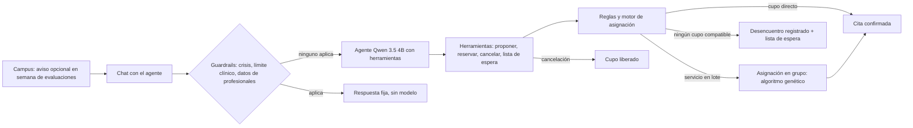

# Cómo funciona AURA

Guía de incorporación para el equipo

## 1. Flujo completo



El **aviso** es una tarjeta opcional del campus; no elige un servicio. El **agente** conversa, recoge motivo y preferencias y llama a las **herramientas** (funciones JSON). Las reglas viven en las herramientas y en el backend, no en el prompt: máximo **3 opciones** por propuesta, servicio pedido por nombre (`service_id_preferido`), un servicio en modo lote como opción de tipo `lote` («Asignación en grupo»), **R7** (una cita activa por persona y tipo de servicio) y cuándo algo es un desencuentro. Antes del modelo corre una capa determinística de **guardrails** (crisis, límite clínico, datos de profesionales) y, si el modelo emite una llamada a herramienta mal formada, hay un respaldo (reintenta una vez y, si falla, responde un mensaje seguro). El motor filtra opciones y, al reservar, verifica de nuevo que el cupo siga libre. Detalle de la conversación y sus endpoints: [api_agente.md](api_agente.md).

## 2. El aviso

**Regla:** en semana de evaluaciones (D7), el aviso aparece con al menos **2 de estas 3 señales**: caída de asistencia, baja de nota y carga de créditos alta. La **semana de evaluaciones es la condición**, no una señal: si no es semana de evaluaciones (`evaluation_week` en D7), el aviso no aparece aunque se cumplan las señales. No se usa la alerta de abandono (`dropout_alert`). Cada señal vale uno si se cumple y cero si no; el **puntaje** (de 0 a 3) es la suma. Los umbrales salen de [parametros.yaml](../config/parametros.yaml) (`aviso`); la fecha de evaluación y los resultados están en [validacion_aviso.md](../salidas/validacion_aviso.md).

| Señal | Regla actual | Fuente |
|---|---|---|
| S1: caída de asistencia | La tasa de asistencia actual bajó al menos **0,05** frente al período anterior. | `aviso.caida_asistencia`, [parametros.yaml](../config/parametros.yaml) |
| S2: baja de nota | `grade_change` es menor o igual que **−0,5**. | `aviso.cambio_nota`, [parametros.yaml](../config/parametros.yaml) |
| S3: carga de créditos alta | Los créditos están en el cuartil superior del período (percentil **0,75**). | `aviso.percentil_carga_creditos`, [parametros.yaml](../config/parametros.yaml) |

Condición: `aviso.evento_evaluacion` (`evaluation_week`). Mínimo de señales: `aviso.puntaje_minimo` (**2**).

**Ejemplo real de D3.** Para `STU_AE_000008`, entre `PER_2026_1` y `PER_2026_2`, la asistencia baja de **0,884** a **0,732** (S1 se cumple); `grade_change` es **0,14**, así que S2 no se cumple; y la carga de **27** créditos alcanza el corte del percentil **27,0** (S3 se cumple). Puntaje: **2 de 3**, por lo que es elegible durante la evaluación de `PER_2026_2`. Los valores académicos salen de `D3_academic_trajectory.csv`; los cortes de [parametros.yaml](../config/parametros.yaml).

D1 no entra en las reglas, no cambia el puntaje y no se entrega al agente: así evitamos usar una encuesta de bienestar personal para decidir a quién contactar. De lo académico, el agente solo puede consultar la **asistencia** de la persona (la señal S1), únicamente cuando ella habla de sus faltas; no ve notas, créditos ni alertas (herramienta `consultar_asistencia`, ver [api_agente.md](api_agente.md)). Con la regla de 2 de 3 señales, los resultados sobre D3 son:

| Período | Estudiantes D3 | Elegibles | % elegible | Fuente |
|---|---:|---:|---:|---|
| PER_2026_2 | 32.500 | 6.925 | **21,31%** | [validacion_aviso.md](../salidas/validacion_aviso.md) |
| PER_2026_3 | 32.500 | 4.809 | **14,80%** | [validacion_aviso.md](../salidas/validacion_aviso.md) |
| PER_2026_4 | 32.500 | 6.829 | **21,01%** | [validacion_aviso.md](../salidas/validacion_aviso.md) |

**Comparación agregada con D1** (solo promedios por grupo, nunca individual; sirve para validar grupos después de calcular el aviso):

| Período | Ansiedad media D1: elegibles | Ansiedad media D1: no elegibles | Fuente |
|---|---:|---:|---|
| PER_2026_2 | **8,12** (n = 2.568) | **8,14** (n = 9.432) | [validacion_aviso.md](../salidas/validacion_aviso.md) |
| PER_2026_3 | **8,28** (n = 1.753) | **8,11** (n = 10.247) | [validacion_aviso.md](../salidas/validacion_aviso.md) |
| PER_2026_4 | **8,15** (n = 2.531) | **8,14** (n = 9.469) | [validacion_aviso.md](../salidas/validacion_aviso.md) |

**Lectura honesta:** con esta regla la ansiedad media de D1 de las personas elegibles es prácticamente igual a la de las no elegibles. El aviso se basa en la trayectoria académica y en el contexto de la semana de evaluaciones, no en un diagnóstico, y estos resultados no lo contradicen: no lo usamos para detectar ansiedad. (La regla anterior de la validación, que usaba `dropout_alert` como señal y exigía 3 puntos, daba 12,91 %, 8,12 % y 13,49 % de elegibles; se reemplazó.) Las medias se calculan solo para estudiantes que aparecen tanto en D1 como en el período de D3; el archivo de resultados conserva medias y tamaños de grupo agregados, no la ansiedad de cada persona. D7 fija las semanas de evaluación; la validación usa la fecha de inicio de evaluación que aparece en `D7_calendar.csv`.

En la demo, la tarjeta del campus se muestra a quien cumple la regla con sus datos académicos simulados (por ejemplo, Lucía cumple las 3 señales, Diego 2 y Mateo y Valentina ninguna). Es una tarjeta opcional («Un espacio para ti»), justificada por la semana de evaluaciones, que la persona puede descartar («Ahora no»); las señales no se le muestran. Fuente: [test_academico.py](../tests/test_academico.py), [aviso_proactivo_service.py](../app/services/aviso_proactivo_service.py).

## 3. Cómo se fabrican los cupos

D6 describe cada servicio: tipo, distrito, horario semanal, capacidad semanal y canales. El generador recorre el horizonte de **2 semanas**, divide los horarios en sesiones de **60 minutos**, reparte la capacidad semanal entre los bloques y asigna cualquier resto a los primeros bloques. Después marca una ocupación inicial de **10%** y libera el **50%** de los cupos restantes. Estos valores y la fecha base **2026-10-01** salen de [parametros.yaml](../config/parametros.yaml); horarios y capacidades, de `D6_services_map.geojson`.

La agenda del experimento grande estima ocupación por servicio con D2; la agenda viva de las herramientas usa la ocupación inicial configurada. En la comparación con D5, cada conversación consulta una copia lógica nueva de la agenda sin reservas: mide compatibilidad, no capacidad agregada ni competencia entre estudiantes.

## 4. Reglas R1–R6

Una **opción** une un cupo con un canal que el servicio ofrece. El motor solo conserva opciones que pasan todas las reglas. Para entenderlas, usamos como ejemplo el perfil de `CONV_AE_000001` en D5: modalidad evening, sin trabajo, prefiere información escrita; D5 la derivó al servicio `SRV_AE_004`, del distrito `DIST_NEBULA`. La comparación D5 produjo la opción `C0000182|digital`. Las demás filas muestran cupos reales de la agenda reproducible y por qué se descartarían con ese perfil o con la variante indicada.

| Regla | En palabras simples | Ejemplo |
|---|---|---|
| R1: horario | El bloque completo cae dentro de un día y una franja permitidos. | `C0000172`, consejería el viernes de **12:00 a 13:00**, queda fuera de la franja evening **17:00–21:00**. |
| R2: afinidad | El tipo de servicio tiene afinidad al menos **0,50** con el motivo. | `C0000301`, career guidance para counseling, tiene afinidad **0,30** y se descarta. |
| R3: canal | El canal debe aparecer tanto en D6 como en los canales aceptados por la solicitud. | `C0000053` ofrece phone; el perfil del ejemplo acepta solo digital. |
| R4: distrito | Si el canal es presencial, el servicio debe ser del distrito declarado. | `C0000036` es presencial en `DIST_GAIA`; para el ejemplo en `DIST_NEBULA` no sirve. Si la solicitud no acepta presencial, también se descarta por R3. |
| R5: fecha futura | La cita debe ser posterior a la fecha base. | La agenda parte de **2026-10-01**; no genera cupos para fechas pasadas ni para ese mismo día. |
| R6: disponibilidad | El cupo debe estar liberado y sin reserva viva. | `C0000200` coincide en horario y servicio, pero pertenece a la ocupación inicial y no está libre. |

Los identificadores de cupo son reproducibles con la configuración actual, los horarios y capacidades de D6 y el generador de [agenda.py](../aura/motor/agenda.py). Las condiciones y la afinidad se implementan en [reglas.py](../aura/motor/reglas.py); el perfil y la opción evaluada de D5 están en [comparacion_d5.csv](../salidas/comparacion_d5.csv).

## 5. Costo individual y canal

El **costo individual** sirve para ordenar las opciones de una persona: menor costo significa una opción preferible. La fórmula actual es:

```text
costo = d / P_canal + beta * (1 - afinidad)
```

`d` son los días de espera desde hoy; `P_canal` es la probabilidad de asistencia asociada al canal; `beta` determina cuánto pesa la afinidad. Los valores configurados son **0,725** para digital, **0,707** para phone, **0,667** para in-person y **5,0** para beta. Fuente: [parametros.yaml](../config/parametros.yaml).

`P_canal` depende del canal, no de quién solicita: el prototipo no personaliza la probabilidad con rasgos individuales. La razón es la señal predictiva limitada: el área bajo la curva ROC (**AUC**, que mide si un modelo ordena casos mejor que el azar) de la regresión logística principal es **0,5407**; gradient boosting logra **0,5092** y el baseline suavizado **0,4998**. AUC **0,5** equivale al azar. Hay una variante exploratoria que incorpora D1 con AUC **0,5501**; está marcada como exploratoria y no se usa para filtrar estudiantes. Fuente: [metricas_modelos.csv](../salidas/metricas_modelos.csv). La política de `P_canal` se conserva como tabla compartida para todas las personas, en [parametros.yaml](../config/parametros.yaml).

## 6. Afinidad provisional

La **afinidad** mide cuánto se parece el tipo de servicio a la necesidad traducida desde el motivo. Los valores y el corte están marcados **PROVISIONAL** en [tablas.yaml](../config/tablas.yaml) y [parametros.yaml](../config/parametros.yaml).

| Motivo ideal ↓ / servicio → | Counseling | Peer support | Career guidance | Fuente |
|---|---:|---:|---:|---|
| Counseling | **1,0** | **0,6** | **0,3** | [tablas.yaml](../config/tablas.yaml) |
| Peer support | **0,6** | **1,0** | **0,4** | [tablas.yaml](../config/tablas.yaml) |
| Career guidance | **0,3** | **0,4** | **1,0** | [tablas.yaml](../config/tablas.yaml) |

Con el umbral actual de **0,50**, counseling puede aceptar peer support como alternativa; career guidance no pasa ese corte para counseling. El equipo debe revisar afinidades y corte con responsables de servicios antes de tratar estos valores como política definitiva.

## 7. Cómo decide el algoritmo genético

Un **cromosoma** es una lista de estudiantes ordenada por prioridad. En la “fila del buffet”, hay cupos C1 martes noche, C2 miércoles tarde y C3 jueves tarde. Ana solo puede tarde; Beto puede tarde o noche; Caro solo puede noche. Con `[Beto, Ana, Caro]`, Beto toma C1, Ana toma C2 y Caro queda sin cita. Con `[Caro, Beto, Ana]`, Caro toma C1, Beto puede tomar C2 y Ana C3: todos consiguen cita. El orden cambia quién llega primero a una opción compatible.

El **decodificador** recorre ese orden, busca la opción libre de menor costo para cada persona y crea el diccionario `asignacion`; si no hay ninguna, registra un desencuentro. El **fitness** (puntuación de calidad que el algoritmo intenta minimizar) combina cinco objetivos:

| Término | Fórmula en palabras | Qué mide | Peso actual |
|---|---|---|---:|
| Z1 | Número de solicitudes sin cita. | Cobertura perdida. | **0,35** |
| Z2 | Suma de `d / P_canal` de las citas. | Espera ajustada por asistencia del canal. | **0,25** |
| Z3 | Varianza de la utilización de los servicios; utilización = asignados / cupos liberados. | Desbalance de carga entre servicios. | **0,10** |
| Z4 | Máximo entre la espera media diurna y la nocturna. | Evita que un grupo cargue con la peor espera media. | **0,20** |
| Z5 | Suma de `1 − afinidad` de las citas. | Pérdida de ajuste entre necesidad y servicio. | **0,10** |

Los pesos salen de [parametros.yaml](../config/parametros.yaml). Antes de sumarlos, cada Z se normaliza con la **tabla de pagos**: los mínimos (`Zmin`) y máximos (`Zmax`) se obtienen de cinco corridas que optimizan cada término por separado. Para un término con rango, se usa `(Z − Zmin) / (Zmax − Zmin)`; si no hay rango, se usa cero. El objetivo total es la suma de cada Z normalizado por su peso. Fuente del método y corridas: [reporte.md](../salidas/reporte.md), [metadatos.json](../salidas/metadatos.json).

El algoritmo crea y mejora muchos órdenes candidatos. Cada mecanismo hace una tarea distinta:

- **Cruce OX:** conserva un tramo del orden de un padre y completa los lugares restantes siguiendo el otro padre; así mantiene a cada estudiante una sola vez.
- **Mutación por intercambio:** cambia de lugar dos estudiantes para explorar otra prioridad posible.
- **Torneo:** escoge varios candidatos al azar y deja que compita el de menor costo.
- **Elitismo:** conserva los mejores candidatos de la generación y evita perder una solución que ya era buena.

La población es de **50** órdenes y se comparan **5** semillas (**42–46**). x1, x2 y x4.3 estándar ejecutan **200** generaciones; x6, x8 y x4.3 con liberación reducida ejecutan **500**. Fuente: [parametros.yaml](../config/parametros.yaml).

## 8. Modo directo y modo lote

El **modo directo** atiende una conversación: propone opciones y reserva cuando la persona elige. El **modo lote** reparte los cupos de los servicios muy ocupados entre varias solicitudes a la vez, con el algoritmo genético de la sección 7. Los dos funcionan en la plataforma.

**Cuándo se activa.** Cada servicio tiene una **utilización**: cupos reservados ÷ cupos liberados de la agenda abierta (la misma «ocupación» del panel). Cuando llega al **75 %** (`modo_lote_umbral_utilizacion: 0.75`, un solo valor en el YAML), el servicio entra en **modo lote**: sus cupos dejan de ofrecerse uno a uno. Ese mismo valor es el corte del nivel de ocupación «alta» (≥ 75 %) y es el que se muestra en Lotes, Reglas, los tooltips y el glosario. Si baja del umbral (por una cancelación), vuelve al modo directo.

**Qué ve la persona: una opción de tipo `lote` («Asignación en grupo»).** El servicio en lote **no se oculta**: `proponer_opciones` lo devuelve como **una sola opción** de tipo `lote` por servicio (con nombre, tipo, cupos libres, tiempo estimado de respuesta y el mensaje «Este servicio tiene mucha demanda; sus cupos se reparten en grupo. Te confirmo en unos segundos.»), ordenada con el costo de su mejor cupo como cualquier otra. Las propuestas traen **como máximo 3 opciones**: primero las del servicio ideal o las del servicio que la persona nombró (`service_id_preferido`, p. ej. «Brújula»); las alternativas afines solo completan si faltan. Si el servicio pedido no tiene cupos compatibles, el backend lo dice (con su fecha más cercana y la mejor opción del mismo tipo en otro servicio).

**Qué le pasa a una solicitud.**

1. Si la persona elige un cupo directo, se reserva ahí mismo (con **R7**: una cita activa por persona y tipo de servicio; si ya tiene una, se le ofrece cambiarla y, si confirma, se cancela la anterior y se reserva la nueva en una sola operación).
2. Si elige una opción de tipo `lote`, su solicitud queda **pendiente** en el **lote abierto**: el primero que entra abre la cuenta regresiva. **Entrar a un lote nunca registra un desencuentro.**

**Cuándo se cierra: solo.** A los `lote.ventana_segundos` (30 s) de entrar la primera solicitud, o apenas junta `lote.tamano_maximo` (5), lo que ocurra primero. Nadie lo cierra a mano.

**Cómo se resuelve.** Al cerrarse, el genético decide un orden de prioridad para todo el grupo y el decodificador asigna a cada persona la opción libre de menor costo (mismas reglas R1–R6, mismo costo individual y mismo fitness Z1–Z5 que en la sección 7). Después la plataforma reserva las citas y avisa a cada estudiante en vivo, **en el mismo chat** y en Mis citas (la cita llega con la línea del canal). A quien no recibió cupo se le ofrecen las opciones que todavía existan; solo si ya no queda **ningún cupo compatible (ni directo ni en lote)** se registra el desencuentro. Dos simplificaciones, por correr en vivo: la normalización de Z usa los límites fijos del «plan B» del experimento (no las cinco calibraciones por lote), y la utilización de Z3 usa como denominador los cupos que aún quedan libres. Si el genético no mejora el orden de llegada, se conserva el de llegada. Con 1 solicitud no hay nada que optimizar.

**Qué esperar.** Como dice la sección 9, el genético no crea capacidad: cuando las solicitudes de un lote no compiten por los mismos cupos, el resultado es igual al de asignar por orden de llegada. Cambia el orden cuando eso reparte mejor (más asignadas, menos espera, más equidad entre diurnos y nocturnos).

Todo vive en RAM y se vacía al reiniciar el backend o la demo. Código: [lote_service.py](../app/services/lote_service.py) (reglas, temporizador, aplicar reservas) y [lote.py](../aura/herramientas/lote.py) (planificación con el genético). Parámetros: `modo_lote_umbral_utilizacion` y el bloque `lote` de [parametros.yaml](../config/parametros.yaml).

### Escenario de la demo

La demo parte de una semana simulada con el motor en modo directo: escenario **x6 (estrés, demanda ×6)**, **10 % de vespertinos que trabajan** (supuesto de simulación; en D5 son 55/2500) y **`hoy` = 2026-11-15** (domingo, último día de la semana de evaluaciones 9–15 nov de D7). La agenda abierta va del 16 al 29 de noviembre (2 semanas). La **espera se mide como `fecha_cupo − fecha_solicitud`**, igual que `wait_days` en D2 (línea base observada en D2: **41,96 días**). Tras reiniciar la demo, la API (`GET /api/coordinacion/resumen`) reporta: 762 citas agendadas, espera media de 4,5 días, 483 de 1.036 cupos liberados reservados (46,6 %), 38 desencuentros y 180 atendidos con un servicio alternativo afín. Con el umbral de 75 % arrancan **3 de 15 servicios en lote**: Espacio Trama Orientación (79,3 %), Espacio Brújula Pares (77,1 %) y Espacio Umbral Orientación (75,0 %) (`GET /api/coordinacion/lotes`); la consejería de Brújula (71,1 %), Lumen (72,9 %) y Nexo (72,4 %) permite reserva directa.

## 9. Resultados del experimento y lectura honesta

La tabla muestra el porcentaje medio asignado de Llegada y Genético, más las esperas del Genético. `±` es la desviación estándar entre las **5** semillas. Los datos vienen de [resumen_5_semillas.csv](../salidas/resumen_5_semillas.csv); generaciones y tiempos, de [reporte.md](../salidas/reporte.md) y [metadatos.json](../salidas/metadatos.json).

| Escenario | Asignados: llegada | Asignados: genético | Espera media GA (días) | Diurnos GA | Nocturnos GA | Desencuentros GA |
|---|---:|---:|---:|---:|---:|---:|
| x1 | 100,00% ± 0,00 pp | 100,00% ± 0,00 pp | 1,91 ± 0,08 | 1,90 ± 0,07 | 1,90 ± 0,19 | 0,00 ± 0,00 |
| x2 | 100,00% ± 0,00 pp | 100,00% ± 0,00 pp | 3,22 ± 0,07 | 3,22 ± 0,06 | 3,24 ± 0,09 | 0,00 ± 0,00 |
| x4.3 | 99,88% ± 0,17 pp | 99,96% ± 0,09 pp | 5,93 ± 0,05 | 5,93 ± 0,05 | 5,93 ± 0,06 | 0,20 ± 0,45 |
| x6 | 87,94% ± 0,69 pp | 87,67% ± 0,41 pp | 6,91 ± 0,07 | 6,91 ± 0,07 | 6,90 ± 0,09 | 88,80 ± 2,95 |
| x8 | 69,81% ± 0,44 pp | 69,90% ± 0,48 pp | 6,91 ± 0,07 | 6,91 ± 0,07 | 6,91 ± 0,07 | 289,00 ± 4,58 |
| x4.3, 25% liberado | 65,89% ± 0,49 pp | 65,89% ± 0,49 pp | 6,94 ± 0,17 | 6,94 ± 0,17 | 6,94 ± 0,19 | 176,00 ± 2,55 |

El genético **no crea capacidad**: cuando la demanda supera los cupos disponibles, siguen existiendo desencuentros. En estas corridas, su aporte más claro es acercar las esperas medias de estudiantes diurnos y nocturnos; con escasez, la asignación total queda parecida a Llegada y en x6 incluso algo menor. Por eso el resultado apoya equidad de espera, no una promesa de más citas. El costo de cada escenario se detalla en [reporte.md](../salidas/reporte.md).

## 10. Supuestos editables

| Supuesto | Valor actual | Archivo donde cambiarlo |
|---|---|---|
| Data Pack externo | Carpeta `data_pack/` (D1, D2, D6, D7; no se versiona: se coloca localmente); `AURA_DATA_DIR` la sobrescribe con el Data Pack completo | [parametros.yaml](../config/parametros.yaml), `data_pack_path` |
| Fecha base / horizonte | 2026-10-01 / 2 semanas | [parametros.yaml](../config/parametros.yaml), `hoy`, `horizonte_semanas` |
| Sesión / cupos liberados / ocupación inicial | 60 min / 0,50 / 0,10 | [parametros.yaml](../config/parametros.yaml) |
| Espera, canal y afinidad | beta 5,0; P digital 0,725, phone 0,707, presencial 0,667; corte 0,50 | [parametros.yaml](../config/parametros.yaml) |
| Motivo → servicio y afinidades | Tablas completas en YAML; valores provisionales | [tablas.yaml](../config/tablas.yaml) |
| Pesos multiobjetivo | Z1 0,35; Z2 0,25; Z3 0,10; Z4 0,20; Z5 0,10 | [parametros.yaml](../config/parametros.yaml), `pesos_z` |
| Aviso | Condición: semana de evaluaciones (D7). Señales: caída de asistencia 0,05; baja de nota −0,5; carga de créditos en el percentil 0,75; mínimo 2 de las 3 | [parametros.yaml](../config/parametros.yaml), `aviso` |
| Modo lote | Umbral 75 % de utilización; ventana 30 s; tope 5 solicitudes | [parametros.yaml](../config/parametros.yaml), `modo_lote_umbral_utilizacion` y `lote` |
| Opciones y equidad | Máximo 3 opciones por propuesta; R7: 1 cita activa por persona y tipo de servicio | [parametros.yaml](../config/parametros.yaml), `max_opciones` y `max_citas_activas_por_tipo` |
| Corridas del experimento | población 50; semillas 42–46; escenarios y generaciones en YAML | [parametros.yaml](../config/parametros.yaml), `experimento` |

## 11. Glosario

| Término | Significado simple |
|---|---|
| AUC | Medida de cuánto mejor que el azar ordena casos un predictor; 0,5 representa azar. |
| Afinidad | Ajuste entre el motivo y el tipo de servicio. |
| Cupo | Bloque de cita con servicio, fecha, hora y canales posibles. |
| Asignación en grupo (opción de tipo `lote`) | Servicio con utilización ≥ 75 %: sus cupos se reparten entre varias solicitudes a la vez; quien la elige queda pendiente unos segundos y recibe su cita en el chat. |
| Desencuentro | Solicitud para la que no existe **ningún** cupo compatible (ni directo ni en lote) dentro de la ventana y las restricciones de la persona. Entrar a un lote no lo es. |
| R7 (equidad) | Máximo una cita activa por persona y tipo de servicio; si pide otra, se le ofrece cambiarla. |
| Guardrail | Regla determinística que corre antes del modelo (crisis, límite clínico, datos de profesionales). |
| Decodificador | Parte que convierte un orden de prioridad en citas concretas. |
| Fitness | Valor total que el genético intenta minimizar para comparar asignaciones. |
| Genético | Búsqueda que mejora órdenes candidatos mediante cruce, mutación y selección. |
| Normalización | Conversión de objetivos con escalas distintas a rangos comparables. |
| Tabla de pagos | Resultados de las optimizaciones individuales que fijan mínimos y máximos de cada Z. |
| Utilización | Proporción de cupos liberados que se asignaron en un servicio. |
